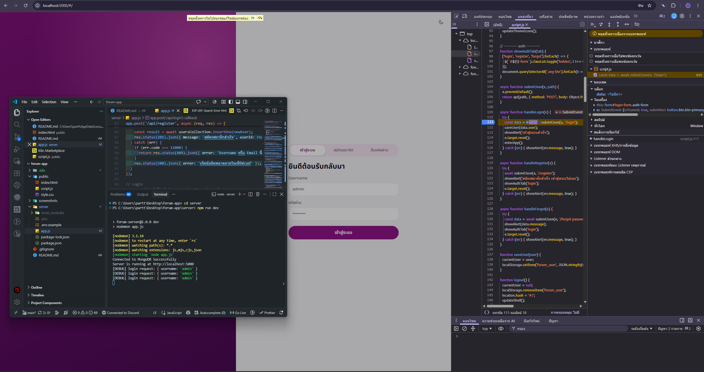
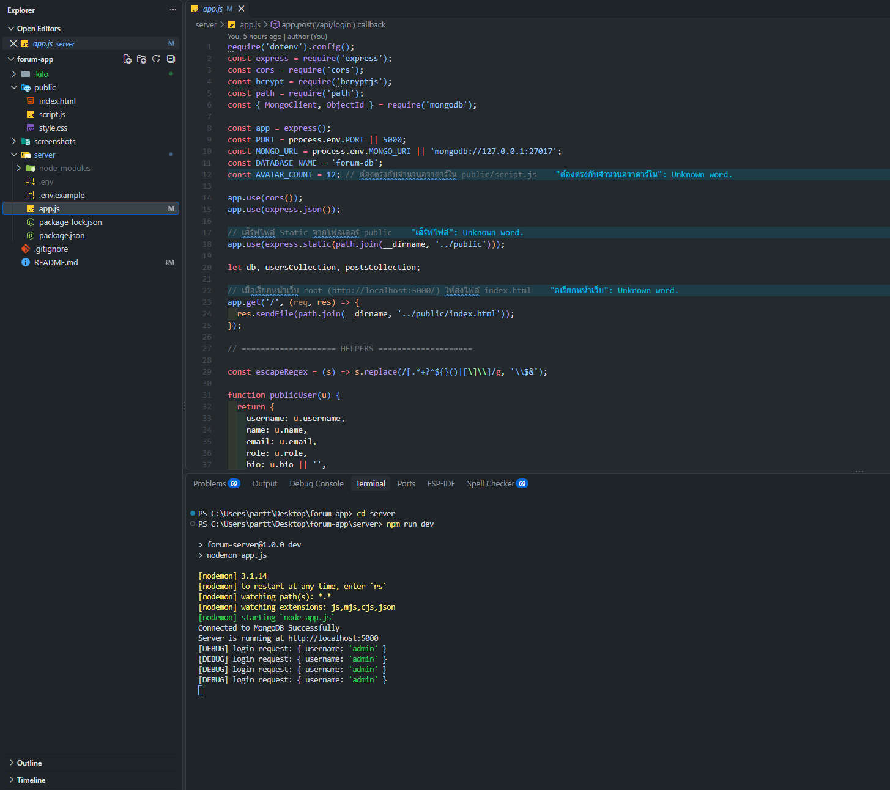

# MiniTalk — Mini Blog & Discussion Forum

เว็บบอร์ด/เว็บบล็อกขนาดเล็กสำหรับตั้งกระทู้และพูดคุย มีระบบสมาชิก โพสต์ ไลก์ คอมเมนต์ โปรไฟล์ และค้นหา/กรองโพสต์
พัฒนาด้วย **Node.js + Express + MongoDB** ฝั่งเซิร์ฟเวอร์ และ **HTML/CSS/Vanilla JS** ฝั่งไคลเอนต์

> โปรเจกต์นี้ใช้รันบนเครื่องตัวเอง (localhost) ไม่ได้ host บนอินเทอร์เน็ต

## แอปทำอะไรได้บ้าง
- **ระบบสมาชิก:** สมัครสมาชิก (เข้ารหัสรหัสผ่านด้วย `bcryptjs`), เข้าสู่ระบบ, ลืมรหัสผ่าน (ยืนยันด้วย Username + Email)
- **โพสต์:** สร้างโพสต์ (หัวข้อ เนื้อหา หมวดหมู่ แท็ก), ดูฟีดเรียงใหม่ไปเก่า, ลบโพสต์ (เจ้าของโพสต์หรือ Admin)
- **ไลก์:** กดไลก์/ยกเลิกไลก์ (1 คนต่อ 1 ไลก์ต่อโพสต์)
- **คอมเมนต์:** คอมเมนต์ใต้โพสต์ ลบได้โดยเจ้าของคอมเมนต์ เจ้าของโพสต์ และ Admin
- **โปรไฟล์:** ดูโปรไฟล์ตัวเองและคนอื่น แก้ชื่อที่แสดง, bio และเลือกอวาตาร์
- **ค้นหา/กรอง:** ค้นหาจากหัวข้อ เนื้อหา แท็ก ผู้เขียน กรองตามหมวดหมู่ และแท็กยอดนิยม
- **UI:** เลย์เอาต์ 3 คอลัมน์บนคอม แถบเมนูล่างบนมือถือ โหมดสว่าง/มืด ต้องเข้าสู่ระบบก่อนจึงเห็นฟีด

## โครงสร้างโปรเจกต์
```text
forum-app/
├── public/              # ฝั่ง Client (Frontend)
│   ├── index.html
│   ├── style.css
│   └── script.js
├── server/              # ฝั่ง Server (Backend)
│   ├── app.js
│   ├── package.json
│   └── .env.example
├── screenshots/         # ภาพหลักฐานการดีบัก
│   ├── client-debug.png
│   └── server-debug.png
├── .gitignore
└── README.md
```

## การติดตั้ง
ต้องมี [Node.js](https://nodejs.org) 18 ขึ้นไป และ [MongoDB](https://www.mongodb.com/try/download/community) ที่รันอยู่ในเครื่อง

```bash
cd server
npm install
cp .env.example .env     # แก้ค่า PORT / MONGO_URI ได้ตามต้องการ
```

| ตัวแปรใน `.env` | ค่าเริ่มต้น | ความหมาย |
|---|---|---|
| `PORT` | `5000` | พอร์ตของเซิร์ฟเวอร์ |
| `MONGO_URI` | `mongodb://127.0.0.1:27017` | ที่อยู่ MongoDB (ฐานข้อมูลชื่อ `forum-db`) |

## การรัน
```bash
cd server
npm run dev      # โหมดพัฒนา (nodemon รีสตาร์ทเองเมื่อแก้ไฟล์)
# หรือ
npm start        # โหมดปกติ
```
เปิดเบราว์เซอร์ที่ http://localhost:5000

## รายการ API Endpoints

### สมาชิก (Authentication)
| Method | Path | Body | หน้าที่ |
|---|---|---|---|
| POST | `/api/register` | `username, name, email, password` | สมัครสมาชิก |
| POST | `/api/login` | `username, password` | เข้าสู่ระบบ |
| POST | `/api/forgot-password` | `username, email, newPassword` | ตั้งรหัสผ่านใหม่ |

### ผู้ใช้ / โปรไฟล์
| Method | Path | Body | หน้าที่ |
|---|---|---|---|
| GET | `/api/users/:username` | – | ดูโปรไฟล์ (ไม่ส่งอีเมล) |
| PUT | `/api/users/:username` | `requestUser, name, bio, avatar` | แก้ไขโปรไฟล์ (เฉพาะของตัวเอง) |

### โพสต์
| Method | Path | Body / Query | หน้าที่ |
|---|---|---|---|
| GET | `/api/posts` | `?q=&category=&tag=&author=` | ดึงโพสต์ (ค้นหา/กรองได้) |
| POST | `/api/posts` | `title, content, author, category, tags` | สร้างโพสต์ |
| DELETE | `/api/posts/:id` | `requestUser, role` | ลบโพสต์ (เจ้าของ/Admin) |
| GET | `/api/trending` | – | จำนวนโพสต์ต่อหมวด + แท็กยอดนิยม |

### ไลก์ / คอมเมนต์
| Method | Path | Body | หน้าที่ |
|---|---|---|---|
| POST | `/api/posts/:id/like` | `username` | ไลก์/ยกเลิกไลก์ |
| POST | `/api/posts/:id/comments` | `author, content` | เพิ่มคอมเมนต์ |
| DELETE | `/api/posts/:id/comments/:cid` | `requestUser, role` | ลบคอมเมนต์ (เจ้าของคอมเมนต์/เจ้าของโพสต์/Admin) |

> **หมายเหตุด้านความปลอดภัย:** ระบบยืนยันตัวตนเป็นแบบง่าย (client ส่ง `username`/`role` มาเอง ยังไม่มี token) และเนื้อหาโพสต์ยังไม่ผ่านการ escape HTML จึงเหมาะสำหรับงานเรียน/ทดลองบนเครื่องตัวเองเท่านั้น

## ภาพหลักฐานการดีบัก

**ฝั่ง Client (DevTools ของเบราว์เซอร์)**



**ฝั่ง Server (Terminal / ผลการเรียก API)**


#
